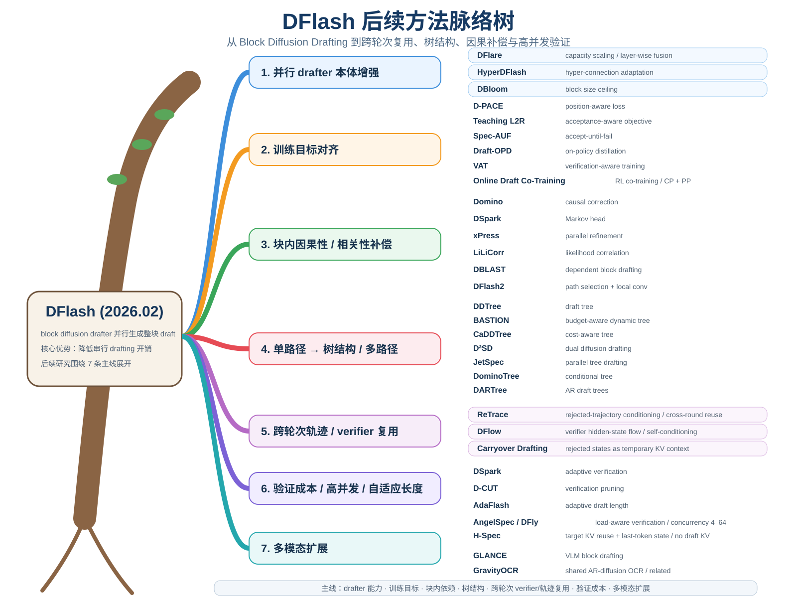

# Awesome Parallel Speculative Decoding

## 工程动态 · Speculative Decoding Engineering Radar

**两条独立维护主线**：新论文与 DFlash 后续方法继续保存在下方论文地图和 `daily/`；新增的真实工程 PR / Issues 则在 [工程雷达快照（2026-10-17）](engineering/2026-10-17.md) 与网站首页 **「工程动态」** 独立显示。

- [工程更新规范、重点项目与复现指标](engineering/README.md) · [结构化数据（5 个项目、23 条 PR/Issue）](src/data/engineering.json)
- 首批关注：**vLLM、vLLM Speculators、SGLang、SpecForge、TensorRT-LLM**；针对 **DeepSeek V4 / V4.1、Kimi K3** 的 Draft/Verify、MLA/KV、长上下文、高并发，以及 **多模态 Draft 训练与 Target KV/Hidden 条件选择**。
- 状态为核查日的 GitHub 快照；必须区分已合并、未合并 PR、Issue/RFC 和 PR 提供的性能数字。历史论文数据保持原状。

## 交互研究地图

本仓库现包含 **DFlash Atlas** 静态网站：首页为可交互脉络图、重点方法卡片和论文优先的每日简报。DFlash 位于脉络图最左侧，所有方法按研究方向和月份从左向右排列；最新 3 篇会显示 `NEW`，可一键定位最新论文，悬停节点查看日期、方向和摘要，并可叠加已核验研究关系。方法卡片展示论文预览、作者、中文摘要和 GitHub Star；支持搜索、月份跳转、方向聚焦、缩放／全屏及卡片—地图双向定位。

- 网站部署地址（启用 Pages 后）：https://joelulu.github.io/Awesome-Parallel-Speculative-Decoding/
- [本地预览、GitHub Pages 部署与数据维护说明](WEBSITE.md)
- 后续网站内容以 `src/data/` 为统一数据源。以下原始时间线和静态图保留作资料归档，尚未逐篇核验。

  

持续跟踪 **Parallel Speculative Decoding / DFlash / Block Diffusion Drafting** 及其直接后续工作。

核心参考：

> **DFlash: Block Diffusion for Flash Speculative Decoding** — arXiv:2602.06036

首页固定按以下顺序维护：

1. **DFlash 后续方法脉络树**：放在最开头，持续按研究主线更新。
2. **DFlash 后续论文时间线**：持续补充引用或直接延伸 DFlash 的工作。
3. **Daily Briefs**：优先收录真正新的 DFlash 后续论文，其次才是重要技术报告和 SGLang / vLLM 工程动态；宁缺毋滥，不为凑数补外围内容。

---

# DFlash 后续论文时间线

| 时间 | Paper | 简单摘要 | 核心动机 | 怎么解决 |
|---|---|---|---|---|
| **2026-04-08** | **Fast-dVLM — Efficient Block-Diffusion VLM via Direct Conversion from Autoregressive VLM** | 将完整 AR VLM 直接转为双模式 block-diffusion VLM，以同一模型并行草拟、因果验证。 | VLM 逐 token 解码难利用硬件并行，先改文本骨干再做视觉对齐又可能破坏预训练多模态能力。 | 直接转换完整 VLM，以 block-size annealing、causal context attention、auto-truncation masking 与视觉拼接训练；共享权重的 diffusion 模式生成块、AR 模式验证前缀，支持 linear 与 quadratic 自投机和定制 SGLang。 ([arXiv](https://arxiv.org/abs/2604.06832)); 共享模型自投机，target 经转换。 |
| **2026-04-14** | **DDTree — Accelerating Speculative Decoding with Block Diffusion Draft Trees** | ⭐ 把 DFlash 从“一条路径”变成“候选树” | 单路径浪费各位置 top-k 候选 | 从 DFlash 各位置 top-k 分布构建 **draft tree**，best-first 搜索后一次性验证整棵树。([arXiv](https://arxiv.org/abs/2604.12989)) |
| **2026-05** | **Test-Time Speculation** | 解决长回答下 acceptance 衰减 | 长生成后出现 distribution shift | 推理过程中做 **test-time / online distillation**。([alphaXiv](https://www.alphaxiv.org/abs/2605.09329)) |
| **2026-05-12** | **D-PACE — Dynamic Position-Aware Cross-Entropy for Parallel Speculative Drafting** | 改 DFlash 的训练 loss | 固定位置权重与真实 first-rejection 位置不一致 | 用 expected accepted length 的可微 surrogate 动态调整各位置 loss 权重。([arXiv](https://arxiv.org/abs/2605.18810)) |
| **2026-05-22** | **Fast-dDrive — Efficient Block-Diffusion VLM for Autonomous Driving** | 驾驶 VLA 按语义段并行起草值 token，固定 JSON scaffold，再由共享 AR 分支验证。 | 完整序列扩散会混淆感知与规划因果顺序；AR 驾驶输出串行慢，固定格式 token 又占用草拟和验证预算。 | 基于 Fast-dVLM 保留段间因果、段内双向关系，以分段加权 loss 和噪声训练；Scaffold Spec 自动接受模板 token，仅并行草拟动态值并以因果 AR forward 验证。 ([arXiv](https://arxiv.org/abs/2605.23163)); Fast-dVLM 扩展，未核实直接继承 DFlash。 |
| **2026-05-28** | **Draft-OPD — On-Policy Distillation for Speculative Draft Models** | ⭐ 用 on-policy 数据训练 drafter | SFT teacher trajectory 与真实 rollout 状态不一致 | 从真实 rollout 的 accepted/rejected token 构造训练信号，做 **on-policy distillation**。([arXiv](https://arxiv.org/abs/2605.29343)) |
| **2026-05-28** | **Domino — Decoupling Causal Modeling from Autoregressive Drafting** | ⭐ 给并行 DFlash 补回因果依赖 | block 内 token 基本独立 | 增加轻量 **causal / prefix-dependent head**。([arXiv](https://arxiv.org/abs/2605.29707)) |
| **2026-05-28** | **BASTION — Budget-Aware Speculative Decoding with Tree-structured Block Diffusion Drafting** | ⭐⭐⭐ 动态树 + 硬件感知预算 | 单路径浪费 top-k；固定 tree budget 又无法适配请求与 GPU | 从 DFlash 分布 best-first 扩展 query-dependent prefix tree，并用 **hardware-calibrated roofline cost model** 在边际接受收益不再覆盖验证成本时停止扩树。([arXiv](https://arxiv.org/abs/2605.29727)) |
| **2026-06** | **TreeFlash — Parallel AR-Approximation for Faster Speculative Decoding** | 并行逼近 AR dependency | DFlash 独立位置预测缺因果性 | 用轻量结构近似 autoregressive conditioning。([alphaXiv](https://www.alphaxiv.org/abs/2606.03819v1)) |
| **2026-06-01** | **CaDDTree — Cost-Aware Diffusion Draft Trees** | DDTree 的系统版升级 | tree 越大 acceptance 越高，但 verifier 也越贵 | 联合优化 **接受收益 + verification latency**，动态选 tree size。([arXiv](https://arxiv.org/abs/2606.01813)) |
| **2026-06-01** | **DFlare — Scaling Up Draft Capacity for Block Diffusion Speculative Decoding** | ⭐ 直接增强 drafter 能力 | DFlash drafter 深度继续扩大后收益受限 | 用 **layer-wise target feature fusion** + 更多训练数据突破 scaling ceiling。([arXiv](https://arxiv.org/abs/2606.02091)) |
| **2026-06-03** | **D²SD — Dual Diffusion Draft Models** | 两级 diffusion drafter | 主路径早期失败后后续预测大量浪费 | 第二个 diffusion drafter 在潜在失败位置生成 alternative continuation，再组成共享前缀树。([alphaXiv](https://www.alphaxiv.org/abs/2606.04446)) |
| **2026-06-05** | **WhiFlash — Token-Level Cross-Paradigm Routing** | AR / diffusion drafter 动态切换 | 不同 token 更适合不同 drafting 范式 | controller 动态选择 AR 或 diffusion drafting。([arXiv](https://arxiv.org/abs/2606.07710)) |
| **2026-06-11 左右** | **Teaching Diffusion to Speculate Left-to-Right** | 让训练目标和 verifier 行为一致 | verifier 只关心 first-error 前 prefix | 对前部 token、first-error 附近和连续正确链特殊 weighting/reward。([alphaXiv](https://www.alphaxiv.org/abs/2606.11552)) |
| **2026-06-16 · v5 2026-10-03** | **JetSpec — Breaking the Scaling Ceiling of Speculative Decoding with Parallel Tree Drafting** | 并行生成带因果依赖的候选树，减少串行建树开销。 | DFlash 快但缺 causality；传统 tree 有 causality 但路径生成开销高 | 用 target hidden state + causal parallel draft head 一次性给大量 tree branches 打分。 ([arXiv](https://arxiv.org/abs/2606.18394)) |
| **2026-06-20** | **PRESTO — Prefix-Aligned Tree Drafting for Diffusion Speculative Decoding** | 将 diffusion marginals 与轻量前缀条件分数结合，以优先级搜索选取更可能被验证接受的树。 | diffusion 边缘概率缺少路径条件，直接相乘会错误排序候选前缀，并浪费树预算。 | 以 log marginal 加权融合前缀条件信号，论文用 trigram；以 best-first 或 beam search 加全局保留分配树节点，适配独立 DFlash drafter 和共享模型自投机。 ([arXiv](https://arxiv.org/abs/2607.22634)) |
| **2026-06-29** | **HyperDFlash** | 适配 Hyper-Connection 模型 | 新架构 hidden representation 与普通 Transformer 不同 | 用 HC-aware gated residual reduction 转换 target hidden states。([alphaXiv](https://www.alphaxiv.org/abs/2606.26744)) |
| **2026-07/08** | **Speculative Correction — Draft-then-Refine Decoding for Diffusion LMs** | 相邻路线 | diffusion LM 的双向上下文能力未充分利用 | 先生成整段 draft，再做 bidirectional diffusion refinement。([arXiv](https://arxiv.org/abs/2608.02625)) |
| **2026-07-02** | **Spec-AUF — Accept-Until-Fail Training** | ⭐ 极简单但合理的 loss 修改 | first fail 后 token 不会被接受，却仍参与 CE | **loss 只计算到 first fail**。([arXiv](https://arxiv.org/abs/2607.01893)) |
| **2026-07-06** | **DSpark — Confidence-Scheduled Speculative Decoding with Semi-Autoregressive Generation** | ⭐⭐⭐ DFlash 重要直接改进 | ① block 内缺依赖；②固定验证整块浪费 | **low-rank Markov Head + confidence head**，兼顾因果补偿和 adaptive verification。([GitHub](https://github.com/vllm-project/speculators/blob/main/docs/user_guide/algorithms/dspark.md)) |
| **2026-07-08** | **DeLS-Spec — Decoupled Long-Short Contexts** | 不重训 DFlash 的因果增强 | Domino/DSpark 等整体重训成本高 | 冻结 DFlash，只训练轻量 local short-context head 并做 logits 融合。([arXiv](https://arxiv.org/abs/2607.07409)) |
| **2026-07-09** | **DominoTree** | Domino + DDTree | DDTree 建树仍近似位置独立 | 用 Domino 的 path-conditioned score 做 best-first tree construction。([arXiv](https://arxiv.org/abs/2607.08642)) |
| **2026-07-16** | **D-CUT — Adaptive Verification Depth Pruning for Batched Speculative Decoding** | ⭐⭐⭐ 高并发重点工作 | 高并发时 verifier 走向 compute-bound，固定长 block 产生验证浪费 | 给 batch 一个 **global verification budget**，结合 confidence 与 runtime cost 动态裁剪 verification depth。([arXiv](https://arxiv.org/abs/2607.14647)) |
| **2026-07-21** | **AdaFlash — Adaptive Speculative Decoding via On-Policy Distilled Diffusion Drafters** | ⭐⭐⭐ OPD + adaptive DFlash | 最佳 draft length 随 domain / request / token 状态变化 | **reverse-KL on-policy distillation + adaptive length head**。([arXiv](https://arxiv.org/abs/2607.19223)) |
| **2026-07-28** | **AngelSpec / DFly — Towards Real-World High Performance Inference with Speculative Decoding** | ⭐⭐⭐ 架构增强 + 高并发自适应验证 | workload、request、在线 load 与硬件异质性让固定 drafter / verify depth 不稳 | DFly 用 **hybrid target-conditioning + predecessor-conditioned AR head**，再集成 D-CUT 分配 batch-level verification budget；覆盖 concurrency 4–64。([arXiv](https://arxiv.org/abs/2607.25852)) |
| **2026-08-03** | **xPress — Parallel Refinement for Diffusion Drafters** | ⭐⭐⭐ 解决独立预测问题 | 各位置 top-1 单独合理，但组合起来不一定 coherent | 用轻量 **parallel causal refiner** 一次性修正整个 block。([alphaXiv](https://www.alphaxiv.org/abs/2608.02438)) |
| **2026-08-05** | **DBLAST — Dependent Block Drafting for Stochastic Speculative Decoding** | 让 block token 显式相关 | stochastic sampling 下独立 marginals 容易组成低联合概率序列 | 引入 block-level **categorical latent variable**。([ResearchGate](https://www.researchgate.net/publication/411824644_DBLAST_Dependent_Block_Drafting_for_Stochastic_Speculative_Decoding)) |
| **2026-08-13** | **DARTree — Speculative Diffusion Decoding with Autoregressive Draft Trees** | ⭐⭐⭐ 当前非常重要 | diffusion tree 缺路径条件 | 把 AR correction head 从 chain 推广到 **candidate tree**，批量扩展 path 后 best-first pruning。([arXiv](https://arxiv.org/abs/2608.13524)) |
| **2026-08-18** | **DFlash 2 — Keep Drafting Parallel** | ⭐⭐⭐ 工程上很值得跟 | 正确 token 常在 top-k，但组合路径选错 | **candidate/path selection + lightweight local convolution**。([Hugging Face](https://huggingface.co/wyattearp/Qwen3.8-27B-DFlash2)) |
| **2026-08-20** | **LiLiCorr — Lightweight Likelihood Correlation of Parallel Drafts** | ⭐⭐⭐ 与 DFlash2/xPress 同一核心问题 | marginal logits 不表达候选组合是否合理 | 计算轻量 **adjacent compatibility / cosine score** 后选 joint path。([arXiv](https://arxiv.org/abs/2608.20530)) |
| **2026-08-30** | **ReTrace — Rejected-Trajectory Conditioning for Speculative Decoding** | ⭐⭐⭐ 把被拒绝的 suffix 从“废计算”变成下一轮条件信息 | 标准 prefix verification 在 first rejection 后直接丢掉后续 draft suffix，但这些 hidden states 仍保留与 target continuation 对齐的语义/结构信息 | 保留 first-rejection 之后的 rejected hidden trajectory，**对齐到下一轮 block → 用同一次 verification 得到的 target states 做 target-aware correction → gated residual fusion 注入下一轮 drafter输入**；不额外增加 target/drafter forward，verification 规则不变，因此保持 lossless。([arXiv](https://arxiv.org/abs/2608.29748)) |
| **2026-08-31** | **Verification-Aware Training (VAT)** | ⭐ 从 verifier 反过来训练 drafter | CE accuracy 不等于 speculative acceptance | verification head 学 survive/reject pattern，并对 first-rejection 周围动态重加权。([arXiv](https://arxiv.org/abs/2608.30135)) |
| **2026-08-31** | **Ceiling-Clipped Acceptance Histograms / DBloom** | 研究 block size ceiling | 频繁 full-accept 时固定 block=16 变成 ceiling | 用 full-acceptance histogram 判断 ceiling，再扩展 block horizon。([arXiv](https://arxiv.org/abs/2608.30427)) |
| **2026-08-31（v2：09-29）** | **GLANCE — Vision Is Not Overhead: One-Pass Block Drafting for Lossless Speculative Decoding in VLMs** | ⭐⭐⭐ DFlash 风格块扩散草稿进入 VLM | 自回归视觉 drafter 成本高，压缩/隐藏图像后又失去 grounded 文本所需证据 | 读取 target 已融合的视觉语言 hidden states，一次起草 block diffusion，再以一次 target pass 验证候选树；grounding 类任务获益更明显，captioning 可能减速。([arXiv](https://arxiv.org/abs/2609.00355), [official code](https://github.com/js-lee-AI/GLANCE)) |
| **2026-09-06** | **DFlow — Enabling Verifier Information Flow in Block Diffusion Speculative Decoding** | ⭐⭐⭐ 让 verifier 信息跨 drafting round 流动 | first rejection 后 target 已计算出的 suffix hidden states 被直接丢弃，下一轮又从 accepted prefix 重新猜 | 将 rejected suffix 的 verifier hidden states 带到下一轮，并通过 **self-conditioning** 训练 drafter 利用跨轮信息。([arXiv](https://arxiv.org/abs/2609.06498)) |
| **2026-09-07** | **Online Draft Co-Training for Speculative Decoding in Large-Scale, Long-Context RL Post-Training** | ⭐⭐⭐ DFlash / DSpark 进入 RL online co-training | policy 持续更新时静态 drafter 会逐渐失配，branch attention / target taps 又难直接扩到 CP/PP | 用 **packed zigzag-ring branch attention + TapChannel** 支持同步训练 policy 与 DFlash/DSpark，扩展到 122B target / 256K context。([arXiv](https://arxiv.org/abs/2609.07108)) |
| **2026-09-09** | **NCP-ArchPreview — NCP-ArchPreview Technical Report: Moving towards Latent Space Language Models through Next Concept Prediction** | 将已验证前缀的概念表示注入 DFlash2/DFlare drafter，改善块内预测一致性。 | 块并行草稿缺少跨多个未来位置的整体语义条件，仅 token-level target features 仍会产生不连贯候选。 | 取最后完整 target chunk 的 concept，经 RMSNorm 与零初始化门控注入各 draft 层；在 DFlash2 局部卷积/路径选择和 DFlare 逐层特征融合之上增加条件。 ([arXiv](https://arxiv.org/abs/2609.10715)) |
| **2026-09-15（历史补收）** | **LoopSpec — Pipelined Self-Speculative Decoding for Looped Transformers** | 从 early-loop 状态直接草拟，用共享骨干流水线推进与深层验证重叠。 | 循环模型每 token 需多次重读相同权重，解码串行；此路线不是 DFlash 直接改法。 | 无需重训/新增 drafter；可选二次 proposal + gating，最高 6.83× 相对 AR。([arXiv](https://arxiv.org/abs/2609.17184), [code](https://github.com/kaist-flexml-lab/loopspec)) |
| **2026-09-15** | **Carryover Drafting — Recycling Rejected States for Speculative Decoding** | ⭐⭐⭐ 把 rejected target states 变成下一轮可注意的 temporary KV | verifier 已为 rejected suffix 付出计算，但传统流程直接丢弃；训练时也缺少 inference-aligned rejected states | 将 rejected target hidden states 作为 bounded temporary KV context，并用 **parallel draft–verify–draft training** 对齐训练/推理；在 DFlash 与 DSpark-derived drafter 上验证。([arXiv](https://arxiv.org/abs/2609.14717)) |
| **2026-09-21** | **H-Spec — H-Spec: Parallel Speculative Decoding Without a Drafter-Side KV Cache** | 用末位 target hidden state 与原位 target KV 共同条件化并行 drafter，消除独立 drafter KV cache。 | DFlash 为每个输入位置投影并维护额外 draft KV，并发时显存与写入成本累积；仅直接复用 target KV 又削弱块后部接受率。 | Mamba 以末位 target hidden states 初始化，attention 原位读取 target KV；parallel scan 保持块并行，并采用 DSpark Markov head 补偿因果依赖。 ([arXiv](https://arxiv.org/abs/2609.24197)) |
| **2026-09-22** | **GravityOCR — Diffusion Drafts, AR Verifies: Accelerating Document OCR with Self-Speculative Decoding** | 共享参数的 block-diffusion 草稿与 AR 验证，让 OCR 并行生成后再提交可信前缀。 | OCR 并行预测的 token 可能各自合理但组合破坏文本顺序或表格、公式结构；独立 drafter 又增加模型维护成本。 | 联合训练同一模型的 AR 与 block-diffusion 路径，先并行草拟再因果验证；在 AR 路径做 GRPO，同步更新共享参数。 ([arXiv](https://arxiv.org/abs/2609.26638)) |
| **2026-09-23** | **DPara — When Parallel Drafter Meets Parallel Speculative Decoding** | 预计算所有接受边界，让 diffusion backbone 与验证重叠，消除猜错 bonus token 导致的串行回退。 | 块并行 drafter 仍在每轮关键路径上；猜测验证结果的重叠调度会因预测失败而回退。 | 从 DSpark 微调多锚点 M-DFlash backbone，冻结 AR head；验证时预计算全部边界，结果揭晓后选分支并用真实 bonus token 驱动轻量 head。 ([arXiv](https://arxiv.org/abs/2609.27396)) |
| **2026-09-28** | **RecGuide — Reciprocal Guidance** | 按并发负载联合调度 diffusion 草拟与 AR 验证，改善固定草稿预算的效率。 | 低并发时两阶段串行，高并发时统一长块增加计算成本。 | 低负载预测纠错/续写分支并与验证合批；高负载结合验证历史和硬件成本选择块长并分桶调度。 ([arXiv](https://arxiv.org/abs/2609.34388))；共享骨干相关路线，非 DFlash 直接扩展。 |
| **2026-09-28** | **DSpine — Draft in Parallel, Condition Through Depth: Adjacent Causal Injection for Speculative Decoding** | 逐层把前驱预测特征注入后继，在并行 DFlash 骨干内部建立相邻因果依赖。 | 独立位置的预测缺少真实前驱条件；只在骨干输出后做因果校正，无法帮助浅层形成更好的后继表示。 | 在每个 draft 层后以门控注入相邻前驱预测特征，使用 block-causal attention；将冻结 LM-head 嵌入映射到 PCA 白化的低维空间，以逐层余弦监督训练浅层预测，并用同一注入算子做末次修正和预计算候选转移。 ([arXiv](https://arxiv.org/abs/2609.36173)) |
| **2026-09-29 · 博客 09-28** | **LongSpark — Efficient speculative decoding with a fixed-cost parallel drafter** | 用固定大小的三种 target 上下文视图，让并行 drafter 成本不再随前缀长度增长。 | DFlash/DSpark 每轮读取完整前缀，长上下文下草拟延迟和独立状态持续增长。 | 融合边界 hidden state、原位近期 KV 窗口与可增量更新的全局注意力摘要；并行 backbone 后接 DSpark 式低秩因果修正。 ([arXiv](https://arxiv.org/abs/2609.37029)) |
| **2026-09-29** | **DScale — Scaling Block-Diffusion Speculative Decoding with Adaptive Verification** | 保留 DFlash 草稿长度与权重，跨请求分配一半验证槽位并消除 padding。 | 高并发时 DFlash 的固定宽度验证产生大量 padding；各请求接受长度不同，统一缩短又会丢失有价值的候选，动态前缀还难以兼容固定形状 CUDA Graph。 | 用 path-aware tiles 区分 prefill 与 verify；112K 参数接受长度预测器估计每请求前缀收益，并以 DVL 在总验证预算减半时重分配候选；固定地址工作区把动态边界贯穿验证和接受步骤，复用已捕获 Graph。drafter 架构、权重和完整草稿长度均不变。 ([arXiv](https://arxiv.org/abs/2609.37532)) |
| **2026-09-30** | **UBTree — Parallel Tree Drafting via Unigram and Bigram Models for Speculative Decoding** | DFlash 并行提出 unigram 候选，以可查表的 bigram 兼容分数构建更有条件相关性的树。 | 独立候选分布无法给不同前驱下的树分支可靠打分；只训练主路径又削弱候选池多样性。 | 在预训练 DFlash proposer 上训练 target 嵌入衍生的两套 MLP bigram codebook、深度缩放与 selector；候选对神经打分并行，再用 DARTree 的逐深度搜索和全局剪枝建树。高温 target 轨迹配合 proposer CE 和候选支持集重归一化的 forward-KL 训练。 ([arXiv](https://arxiv.org/abs/2609.39972)) |
| **2026-10-01** | **DRelay — Global Draft Context for Prefix-Aware Parallel Speculative Decoding Repair** | 读取整块候选分布，用实际已选前缀决定 KEEP/REPAIR，在 target 验证前修复早期选错。 | 早期 token 选错会截断可接受前缀，即使正确 token 已在 top-k 池、后续预测也可提供辨别证据，单向因果 head 仍无法回看这些信息。 | Global Read 并行读取 top-16 候选和后续预测；Causal Selector 逐位置查询可寻址的已选前缀及严格已验证历史，门控保留或替换候选。联合训练候选支持、修复 gate/rank，以到达概率和后续连续接受价值加权修复 loss。 ([arXiv](https://arxiv.org/abs/2610.01439)) |
| **2026-10-04** | **SharpDraft — Accelerating Long-Context Speculative Decoding with Cardinality-Aware Query Scaling** | 按可见 Key 数缩放 DFlash query，无需更新权重即可缓解长生成的 attention mass dilution。 | 长上下文使 softmax 竞争 Key 增多，重要 Key 的 attention mass 被稀释；接受率降低，在线重训又增加延迟和显存。 | 在 Q-normalization 后应用带上限的长度相关 query scale，以参考 Key 数和固定斜率近似 top-k mass 校正；target、验证规则和缓存 K/V 均保持原实现。 ([arXiv](https://arxiv.org/abs/2610.05106)) |
| **2026-10-05** | **D-Loop — Looped Diffusion Drafting** | 同一 DFlash 骨干先起草整块，再暴露候选前缀重生成后缀。 | 并行边缘预测缺因果信息，容易产生重复词；需要额外一次草拟前向。 | 以置信度挑选分割位置并训练互补 prefix/suffix 目标，复用原权重；关注 draft 耗时能否由接受长度补偿。([arXiv](https://arxiv.org/abs/2610.06011)) |
| **2026-10-06** | **DLoop — Looped Speculative Decoding** | 自适应连续草拟多块后合并验证。 | 经常整块全收却每轮都执行 target verify；未来块缺少已验证 hidden。 | 用 loop-aware hidden conditioning 继续起草，再统一 target 验证；不同于 D-Loop 的块内修复，适用于 DFlash/DSpark。([arXiv](https://arxiv.org/abs/2610.07659)) |
| **2026-10-08** | **DCOCO — Contextual Correction** | 并行学习相邻 top-k 候选转移，轻量选择 prefix-first 路径。 | DFlash 的正确 token 常在 top-k，却因各位置独立 top-1 而选错组合。 | 单次 backbone 后并行计算候选对得分，顺序选择前缀；在论文 4–32 并发测试中领先最强对手 6–23%。([arXiv](https://arxiv.org/abs/2610.12570)) |
| **2026-10-07** | **DScout — Factorization-Guided Training and Inference** | 用前缀接受率指导 DFlash 式块扩散训练，并按吞吐选推理配置。 | 后段预测会因前段拒绝失效；提高 MAT 也可能增加单轮延迟。 | 混合长度、块内部分揭示、接受率加权 loss；按 MAT/每轮延迟选择条件层数、drafter 深度和块长。([arXiv](https://arxiv.org/abs/2610.23935), [PDF](https://arxiv.org/pdf/2610.23935)) |
| **2026-10-14** | **JetSpec++ — Foresight Parallel Drafting** | 一边提高块内接受长度，一边利用跨块 foresight 和 pipeline 隐藏草拟延迟。 | 草稿越强通常越慢，串行 draft→verify 存在关键路径瓶颈。 | self-refinement + next-block foresight + draft/verify overlap；GB200 单请求论文报告最高 7.45× AR。([arXiv](https://arxiv.org/abs/2610.19792)) |
| **2026-10-14** | **TreeSpark — Learning to Draft the Trees You Verify** | DSpark 树草拟在训练阶段重放真实搜索与预算打包。 | 只训练 teacher-forced 单路径不能直接优化多父节点树候选。 | survival NLL + coverage hinge 对保留边与 target 重要分支监督；相对 DSpark 报告单请求吞吐提升 15.1–25.0%。([arXiv](https://arxiv.org/abs/2610.20175)) |
| **2026-10-14** | **FOLD — Position-Free Far Memory** | 局部 KV 保留相对位置，旧 KV 归入共享位置的远端记忆。 | 短上下文 drafter 长度泛化差；远端上下文可能稀释 attention。 | 局部/远端分开归一化并调节远端质量；DFlash/DSpark 最长测到 256K。([arXiv](https://arxiv.org/abs/2610.20392), [code](https://github.com/NuyoahNasuS/FOLD)) |
| **2026-10-14** | **ReaDy — Recurrent States as Dynamic Context** | 在 hybrid linear attention target 中对已提交 recurrent state 做逐位置读取。 | 单次 target hidden 融合缺乏不同未来 token 所需的历史检索。 | 小型 state reader + 低秩读取 + DSpark 残差融合；Qwen3.8-27B / B200 相对 DSpark 吞吐 +7.97%。([arXiv](https://arxiv.org/abs/2610.20503), [code](https://github.com/StartLuxLabs/ReaDy)) |
| **2026-10-14** | **Long-Context Drafting Does Not Require Long-Context Drafters** | 冻结短上下文 drafter，限制 KV 读取并重新映射 RoPE 位置。 | drafter 也处理全前缀时，超长上下文的投机净收益消失。 | 有界 draft cache + RoPE rebasing，在论文目标配置中维持 4K–2M 的短上下文 speedup；不等于绝对速度翻倍。([arXiv](https://arxiv.org/abs/2610.20865)) |
| **2026-10-15** | **LoopAhead — Speculating Ahead in Looped Models** | LAD 从 early-loop 特征草拟多 token，深层 loop 反馈决定继续哪些分支。 | LoopSpec 的早期深度利用和错误分支控制仍不充分。 | 轻量训练 LAD + feedback-gated speculative pipeline；最高 7.82× 为相对 AR，非对 LoopSpec 的倍率。([arXiv](https://arxiv.org/abs/2610.21594)) |

| **2026-10-17** | **FlashMap — Flow Map Speculative Decoding** | 一步联合生成 token 块，保留块内依赖。 | DFlash 单步各位置独立预测，组合可能不一致并截断接受前缀。 | target hidden 条件化连续 flow，蒸馏成一步 flow map；同设置 DFlash 基线下 Qwen3-8B 九任务平均加速高 7.4%，单请求 H200 NVL。([arXiv](https://arxiv.org/abs/2610.24365), [code](https://github.com/al-jshen/flashmap)) |

| **2026-10-19** | **DStill — Trajectory Consistency Distillation** | 把多步块细化蒸馏成一步 drafter，推理保留 DFlash 骨干和延迟。 | DFlash 一步独立预测会组合错误，多步细化则增加前向次数。 | 部分可见块 teacher + 离线细化轨迹 + endpoint CE/top-k KD 与 root-bias 课程；论文报告相对一步 DFlash 墙钟加速最高 +25%。([arXiv](https://arxiv.org/abs/2610.27379)) |

| **2026-10-27** | **MDraft — Multi-Draft On-Policy Distillation for Diffusion Drafters** | 聚合多个草稿前缀的 target 分布，改进 DFlash 的 on-policy 训练。 | 并行草稿的单一位置分布无法同时匹配不同采样前缀下的 target 条件分布。 | 同一上下文采样多个草稿，混合 target 全词表条件分布再蒸馏；保持架构和推理不变。([arXiv](https://arxiv.org/abs/2610.37778)) |
| **2026-10-28** | **TableTune — Measured, Self-Correcting Draft-Length Tables** | 在 vLLM 中实测批量/草稿长度吞吐表并在线修正。 | 固定长度在负载或任务切换后失准；DFlash 额外验证成本随并发变化。 | 实际服务路径量测 step time 与接受率，按 batch 选长度并用插件修正；H100 的 DFlash 任务切换恢复旧表损失的 96%，但画像仍可落后最佳固定长度最多 16%。([arXiv](https://arxiv.org/abs/2610.38968), [code](https://github.com/asm582/tabletune)) |

| **2026-10-29** | **Only Accepted Tokens Count — Energy Accounting** | 实测 DFlash/DSpark 在并发服务下的能耗，发现长块验证可由节能转为耗能。 | 接受长度无法表达所有被验证、却遭拒绝的 token 成本。 | SGLang/CUDA Graph、H100/H200 配对能耗与算术强度测量；Qwen3-4B 的 DFlash-16 在 H100 batch 16–32、H200 batch 16 附近失去节能优势。([arXiv](https://arxiv.org/abs/2610.40287)) |
| **2026-11-02** | **SpecOPD — Branch-Parallel On-Policy Distillation for Speculative Decoding** | 并行采集 on-policy 分支并批量获取 target 监督，优化连续接受长度。 | 传统 OPD 的逐轮草拟与验证使训练监督采集串行，逐 token loss 又未对齐连续接受。 | 从参考轨迹多个锚点采样当前 drafter 分支，打包共享前缀树批量获取 target 监督，用 E2E-TV 优化接受长度。 ([arXiv](https://arxiv.org/abs/2611.02846))。 |
| **2026-11-02** | **HybridSpec — Throughput-Aware Speculative Decoding for Hybrid GDN-MoE Models** | 按收益和 GDN–MoE 验证成本动态选长度，并在路由边界修正。 | GDN–MoE target 的验证长度增加会迅速抬高每轮成本，DFlash 首次拒绝后的计算被浪费。 | GPU 上按接受概率和实测延迟选验证长度，在首个 MoE 路由边界修正，再用并行 GDN kernel 恢复已接受状态。 ([arXiv](https://arxiv.org/abs/2611.04055))。 |
| **2026-11-04** | **D3D — Decoupled Diffusion Drafting for Asynchronous Speculative Decoding** | 去掉跨轮 target hidden 依赖，在验证期间异步准备后续扩散草稿。 | DFlash 每轮需要等待 target hidden 更新，限制下一块草拟与当前验证的重叠。 | 训练独立扩散 drafter，融合块去噪与 AR 监督；验证期间打包预生成拒绝及全接受分支，按接受长度剪枝层。 ([arXiv](https://arxiv.org/abs/2611.06425))。 |

| **2026-11-05** | **ChainFlow — Few-Step Latent Flow Matching for Speculative Decoding** | 一步目标特征流草拟，配合 token feedback 和候选树。 | DFlash 缺块内依赖，大树在高并发时验证昂贵。 | VAE 压缩 target hidden，条件 flow 草拟并反馈修正；Qwen3.5-4B 单 B300、batch 1 的 8×4 树比 DFlash 快 11%，batch≥8 时慢于无投机。([arXiv](https://arxiv.org/abs/2611.08669), [code](https://github.com/Cosmos-YTU/chain-flow))。 |

| **2026-11-14** | **DynaDFlash — Dynamic Feature Projection for Block Diffusion Speculators** | 按 token 动态融合 target hidden 特征。 | DFlash 固定投影不能适应上下文。 | 第 34 层特征生成五层门控；数学题接受长度 +5%，全任务无显著差异。([arXiv](https://arxiv.org/abs/2611.19085), [code](https://github.com/midas-llm-research/DynaDFlash)) |
| **2026-11-13** | **MMFlash — Faster Speculative Decoding for Vision-Language Models** | 用视觉依赖与错误率重加权 DFlash 训练。 | 图像依赖 token 降低接受率。 | 有图/无图 target 分布 KL 引导损失，长视频用稀疏注意力。([arXiv](https://arxiv.org/abs/2611.18482)) |
| **2026-11-08** | **D3Tree — Learning to Prune Block-Diffusion Draft Trees for Efficient Verification** | 学习候选节点存活率，按并发负载分配全批验证预算。 | DFlash 候选树在高并发时验证低收益节点。 | 冻结 drafter 训练存活率头，按父链裁剪闭合子树，按负载与矩阵乘 tile 分配全批预算。([arXiv](https://arxiv.org/abs/2611.11371)) |
| **2026-11-09** | **DForkTree — Accelerating Speculative Decoding with Fork-Aware Block Diffusion Draft Trees** | 用目标输出的 n-gram 路径统计修正分叉后草稿分布，并精确构造预算内候选树。 | DFlash 的逐位置分布按自身主路径预测；树在分叉后仍使用这些分布，条件前缀失配导致预算浪费。 | 从 target 生成文本提取 n-gram，将路径 PMI 加入候选分数，分叉后提高权重，用 GPU 分层搜索构造最优树；无需重训 drafter。 ([arXiv](https://arxiv.org/abs/2611.12356)) |
| **2026-11-09** | **Multi-Future Drafting — Mixture Block Drafters for Tree-Verified Speculative Decoding** | 单次前向生成多种连贯未来，用混合树避免候选预算消耗在拼接假路径上。 | DFlash 的逐位置边缘分布相乘会把不同合理未来拼成 target 不会生成的路径，浪费 DDTree 节点预算。 | 在 drafter 输入加入 K 个可学习模式向量，同一前向生成 K 个连贯草稿块，再用 mixture DDTree 进行无损树验证。 ([arXiv](https://arxiv.org/abs/2611.13017)) |

| **2026-05-30** | **TAPS — Target-Aware Prefix Tree Selection** | ⭐⭐⭐ 在 DFlash 扩散草稿上选择前缀可达的紧凑候选树 | DDTree 仅按位置边际概率选树，浪费验证预算于错误前缀后代 | 离线学习 target 条件接受率、传播路径可达率并按效用阈值剪枝；单请求实验相对 DFlash 平均 1.36×。([arXiv](https://arxiv.org/abs/2606.00487)) |
| **2026-10-07** | **EDR — Training Parallel Speculative Draft Models by Directly Minimizing Expected Decoding Rounds** | 用马尔可夫奖励过程直接最小化预期解码轮数，使训练权重反映跨轮到达概率和拒绝成本。 | 块内 CE 或接受长度替代目标忽略一轮拒绝位置如何改变后续轮起点，无法直接优化全局 target 调用次数。 | 将解码表示为 Markov reward process，推导精确 EDR 目标与时间差分梯度，并用 target rollouts 作无偏随机优化。 ([arXiv](https://arxiv.org/abs/2610.10411)) |
| **2026-09-30（补漏）** | **ALR + IRA — Recovering Off-Policy Supervision for Speculative Decoding** | 恢复 DFlash 在固定外部语料中失效的块内训练信号。 | 一处离策略 token 使后续位置不再对应 target 续写，擦除标签损失监督。 | 用 target rollout 的分布重标记全部槽位，并在 rollout 内放置锚点复用 target 特征。([arXiv](https://arxiv.org/abs/2609.38795), [官方代码](https://github.com/js-lee-AI/ALR-IRA)) |
| **2026-09-29（补漏）** | **CAST — Cost-Aware Speculative Trees from One-Pass Block Drafters** | 将 DFlash 已评分的替代候选变为可验证树，并按延迟决定树宽。 | 单链浪费候选概率，固定宽树又可能吃掉接受收益。 | 用路径概率排序前缀闭合候选，实测 target 验证增量时间并据此停止扩树；不改 DFlash 权重。([arXiv](https://arxiv.org/abs/2610.00321), [官方代码](https://github.com/js-lee-AI/CAST)) |
| **2026-10-05（补漏）** | **AdaSpark — Adaptive DSpark with Online Learning for Tree Verification and N-gram Fill** | 服务中学习 DSpark 树验证成本与接受率。 | 离线成本表不能稳定覆盖新上下文和部署环境。 | 在线拟合按树宽和上下文变化的验证时间及候选接受率，使 DSpark 与 n-gram 候选共享验证预算；未直接评测 DFlash 原版。([arXiv](https://arxiv.org/abs/2610.05774), [官方实现](https://github.com/zeraix/imparo)) |
| **2026-10-20** | **D-PAL — Acceptance-Derived Weights and Distributional Losses** | 用 target/draft 分布重叠改进 DFlash 的接受率训练目标。 | D-PACE 仅看记录 token 的 draft 概率，忽略完整分布重叠。 | 从期望接受长度导出 overlap 权重，以 Rényi-1/2 等分布损失替代 CE；Qwen3-4B 六任务 T=0 平均接受长度 4.50→4.57（相对 D-PACE）。([原文](https://arxiv.org/html/2610.28355)) |
| **2026-10-21** | **Target Regeneration — 训练目标收益的归因检验** | target 重生成语料会缩小 DFlash 蒸馏与验证门控相对 CE 的收益。 | 外部回答上的 loss 增益可能混入语料与 target 的分布差异。 | 在 DFlash drafter 上对照外部与 target 重生成回答的 CE/KD/KD+gate，加入训练长度控制；用于训练评估基线，不是新推理算法。([原文](https://arxiv.org/html/2610.29013)) |

### ReTrace / DFlow / Carryover Drafting：跨轮 rejected state reuse

ReTrace 首次明确利用 **上一轮 rejected trajectory** 做 **cross-round conditioning**；DFlow 进一步强调 **verifier information flow**，直接把 first rejection 之后已经算出的 target hidden states 作为下一轮 drafting 条件；Carryover Drafting 则把 rejected target states 组织为下一轮 drafter 可选择性 attention 的 **temporary KV context**，并用 parallel draft–verify–draft training 对齐训练与真实推理状态。三者共同形成一条连续的跨轮复用主线，并且天然适合继续与 DFlash2 / DSpark / D-CUT 等方法组合。

---

# Daily Briefs

历史补档：[2026-10-10](daily/2026-10-10.md) · [2026-10-14](daily/2026-10-14.md) · [2026-10-15](daily/2026-10-15.md) · [2026-10-16](daily/2026-10-16.md)

## 2026-11-19

补录 [DynaDFlash](https://arxiv.org/abs/2611.19085)：动态 target 特征融合在数学题有小幅收益，全任务未显著改善。

[查看 2026-11-19 日报](daily/2026-11-19.md)。

## 2026-11-13

补录 [DForkTree](https://arxiv.org/abs/2611.12356) 与 [Multi-Future Drafting](https://arxiv.org/abs/2611.13017)：分别修正分叉后条件失配与多未来拼接假路径造成的树预算浪费。

[查看 2026-11-13 日报](daily/2026-11-13.md)。

## 2026-11-12

> **暂无重要新增。** 定向复查近期与历史遗漏的 DFlash、块扩散草稿和并行投机论文；已收录工作去重，未确认直接相关的新论文或重要官方实现。

[查看 2026-11-12 日报与筛选说明](daily/2026-11-12.md)。

## 2026-11-10

补录 [ChainFlow](https://arxiv.org/abs/2611.08669)：一步 latent flow、token feedback 和候选树在单请求下领先 DFlash；高并发时树验证开销成为瓶颈。

[查看 2026-11-10 日报与核查说明](daily/2026-11-10.md)。

## 2026-11-09

补录 [MDraft](https://arxiv.org/abs/2610.37778)：直接微调 DFlash，以多草稿 target 分布聚合缓解块内前缀条件不一致；原文只报告接受长度，尚无端到端速度对照。

[查看 2026-11-09 日报与核查说明](daily/2026-11-09.md)。

## 2026-11-06

补录 [SpecOPD](https://arxiv.org/abs/2611.02846)、[HybridSpec](https://arxiv.org/abs/2611.04055)、[D3D](https://arxiv.org/abs/2611.06425) 三篇直接相关论文，分别研究训练、验证和异步草拟。D3D 速度表使用不同 GPU 数量，需等资源复测。

[查看 2026-11-06 日报与核查说明](daily/2026-11-06.md)。

## 2026-11-05

论文优先复查暂无核验到新的直接后续论文。补录 [SGLang DFlash 数据并行 CUDA Graph 提案（PR #47770，仍待合并）](https://github.com/sgl-project/sglang/pull/47770)：拟在数据并行副本空闲时保持 draft 与 verify 的 CUDA Graph 回放，降低 eager launch 开销；性能数字来自 PR 作者，尚未独立复测。

[查看 2026-11-05 日报与核查说明](daily/2026-11-05.md)。

## 2026-11-04

> **暂无重要新增。** 复查 DFlash 后续论文及 SGLang、vLLM、TensorRT-LLM 官方动态；[SGLang v0.5.23](https://github.com/sgl-project/sglang/releases/tag/v0.5.23) 所列可核验 DFlash 修复对应旧 PR，本期不重复收录。

[查看 2026-11-04 日报与核查说明](daily/2026-11-04.md)。

## 2026-11-03

> **补录 1 篇直接测试 DFlash 的论文。** [Only Accepted Tokens Count](https://arxiv.org/abs/2610.40287)量化高并发下的验证能耗；[vLLM v0.33.0](https://github.com/vllm-project/vllm/releases/tag/v0.33.0)发布 DFlash/DSpark 服务改进。

[查看 2026-11-03 日报与路线判断](daily/2026-11-03.md)。

## 2026-10-28

> **补录 1 篇历史遗漏论文。** [DScout](https://arxiv.org/abs/2610.23935)（10 月 7 日提交）直接沿用 DFlash 骨干，以前缀接受概率指导训练，并按 MAT/每轮延迟选择推理配置；今日定向扫描未核验到其他重要新增。

[查看 2026-10-28 日报与路线判断](daily/2026-10-28.md)。

## 2026-10-23

> **补录 1 篇历史遗漏论文。** [DLite](https://arxiv.org/abs/2610.23787)（10 月 16 日提交）复用 target 隐状态，以无历史并行 drafter 和轻量顺序头应对 agentic 长上下文下的接受长度下降与草稿 KV 开销；[原文](https://arxiv.org/html/2610.23787v1)直接比较 DFlash/DSpark。今日未核验到其他重要新增。

[查看 2026-10-23 日报与路线判断](daily/2026-10-23.md)。

## 2026-10-22

> **暂无重要新增。** 论文优先补查 DFlash 后续草稿质量、候选搜索、验证成本、训练和跨轮复用，并与现有 60 个方法去重；没有找到经原始来源核验、应当新增的条目。扩散模型自身的 PV-Decoding 不属于本仓库的 DFlash 后续范围。

[查看 2026-10-22 日报与扫描范围](daily/2026-10-22.md)。

## 2026-10-21

> **论文暂无重要新增；新增 1 项官方工程动态。** [vLLM TorchTPU](https://vllm-project.github.io/2026/10/20/vllm-torchtpu.html) 发布 TPU 后端，官方指南给出 DFlash 启动示例，支持矩阵列出 Qwen3-4B 的 DFlash/DSpark 测试覆盖。它扩大了 DFlash 的可运行平台；官方资料尚未给出与 GPU 或 target-only 的同条件 DFlash 吞吐对比。

[查看 2026-10-21 日报与扫描范围](daily/2026-10-21.md)。

## 2026-10-20

> **暂无重要新增。** 继续定向检索 DFlash、block diffusion drafting、候选路径、训练、跨轮复用与验证成本；新检索结果未出现经原始来源核验且符合范围的未收录论文。SGLang 的 DFlash 性能 PR 为 10 月初已合并进展，本日不重复记为新增。

[查看 2026-10-20 日报与扫描范围](daily/2026-10-20.md)。

## 2026-10-19

> **暂无重要新增。** 本轮优先补查 DFlash 与块扩散并行草稿论文，并与 10 月 17 日已收录的 D-Loop、DLoop、DCOCO、TreeSpark 等条目去重；没有发现经核验的新论文或值得单列的官方实现进展。

[查看 2026-10-19 日报与扫描范围](daily/2026-10-19.md)。

## 2026-10-17

> **新增核验：9 篇 10 月论文 + LoopSpec 历史补收。** 本期重点是 D-Loop 与 DLoop 两种不同的 loop、DCOCO/TreeSpark 的候选修复与树训练、ReaDy/FOLD 的上下文利用，以及 JetSpec++/LoopAhead 的预投机流水线。数据同步到交互网站 `src/data/`；论文卡片使用 CI 从原始 PDF 渲染的首页缩略图。

| 时间 | 新进展 | 为什么值得看 |
|---|---|---|
| 10-15 / 10-14 | [LoopAhead](https://arxiv.org/abs/2610.21594) · [JetSpec++](https://arxiv.org/abs/2610.19792) | 早期预测、错误分支控制与 draft/target 流水重叠；需要测资源竞争，不能只看理论 overlap。 |
| 10-14 | [ReaDy](https://arxiv.org/abs/2610.20503) · [FOLD](https://arxiv.org/abs/2610.20392) · [长上下文短 drafter](https://arxiv.org/abs/2610.20865) | recurrent state 读取、远端 KV 正规化、有界缓存分别降低长历史的 draft 条件化成本。 |
| 10-14 / 10-08 | [TreeSpark](https://arxiv.org/abs/2610.20175) · [DCOCO](https://arxiv.org/abs/2610.12570) | 将真实候选搜索监督或 top-k 相邻条件评分加入草稿，同时考虑吞吐与多并发。 |
| 10-06 / 10-05 / 09-15（补漏） | [DLoop](https://arxiv.org/abs/2610.07659) · [D-Loop](https://arxiv.org/abs/2610.06011) · [LoopSpec](https://arxiv.org/abs/2609.17184) | 跨 block 多轮草拟、块内 prefix/suffix 重草拟、looped target 自投机是三种不同机制。 |

完整技术摘要、官方代码核验、工程问题和最小验证建议见 [2026-10-17 日报](daily/2026-10-17.md)。

## 2026-10-08

> 核验用户提供的 DSpine 后重新补查，新增 7 个论文条目，并更正此前“10 月暂无直接新论文”的结论。近期新工作包括 DSpine、UBTree、DRelay、SharpDraft；PRESTO、Fast-dVLM、Fast-dDrive 为历史补收。LongSpark/JetSpec 补齐论文入口与日期，DScale/GLANCE 的本日既有核验记录保留。

| 时间 | 论文/动态 | 一句话摘要 | 核心问题 | 方法 | 与 DFlash 关系 |
|---|---|---|---|---|---|
| 2026-09-28 / 10-01 | [DSpine](https://arxiv.org/abs/2609.36173) · [DRelay](https://arxiv.org/abs/2610.01439) | DSpine 提前到各层注入前驱预测；DRelay 用全块证据修复早期选择，延长连续接受前缀。 | 块内缺少前驱条件；早期选错会使可用后缀无法提交。 | 逐层相邻因果注入；Global Read + KEEP/REPAIR 因果选择器及前缀价值 loss。 | DSpine 直接扩展 DFlash 骨干；DRelay 明确引用并评测相关框架。均值得加入因果关系与 Training 路线；保留各自顺序选择开销的说明。 |
| 2026-09-30 / 06-20（历史补收） | [UBTree](https://arxiv.org/abs/2609.39972) · [PRESTO](https://arxiv.org/abs/2607.22634) | 以 bigram 或前缀条件信号补足 diffusion marginals，再分配有限树预算。 | 位置独立分数不能可靠排序路径；候选多样性与验证预算需要共同处理。 | UBTree 的 CE/候选集 forward-KL + bigram 查表 + DARTree 搜索；PRESTO 的 trigram 分数与优先级搜索。 | 两者直接在 DFlash 上实现，值得加入 Candidate Search；不同节点预算和服务配置下的速度不能直接横比。 |
| 2026-10-04 / 09-29（论文入口补齐） | [SharpDraft](https://arxiv.org/abs/2610.05106) · [LongSpark](https://arxiv.org/abs/2609.37029) | SharpDraft 修正长生成的 query 缩放；LongSpark 用固定大小 target 视图控制长前缀草拟成本。 | 长上下文既稀释 attention，也使草拟状态和读取成本增长。 | 按 Key 数、参考数量和固定斜率缩放 Q；边界状态 + 近期 KV + 增量全局摘要。 | SharpDraft 直接用于 DFlash；LongSpark 明确分析 DFlash 并结合 DSpark。值得纳入 Draft Quality；前者理论有条件，后者实验额外使用专用 drafter GPU。 |
| 2026-04-08 / 05-22（历史补收）；GLANCE v2 09-29 | [Fast-dVLM](https://arxiv.org/abs/2604.06832) · [Fast-dDrive](https://arxiv.org/abs/2605.23163) · [GLANCE](https://arxiv.org/abs/2609.00355) | 补齐图像理解与驾驶 VLA 的共享模型块扩散自投机，并保留 GLANCE 的冻结 VLM 草稿路线。 | 多模态条件、语义段因果关系和固定结构占用解码预算。 | Fast-dVLM 直接转换 AR VLM、双模式草拟验证；Fast-dDrive 分段 scaffold；GLANCE 利用融合视觉语言 target hidden states。 | Fast-dVLM 引用 DFlash；Fast-dDrive 扩展 Fast-dVLM，未证实直接继承 DFlash；GLANCE 为明确 DFlash 风格扩展。值得加入 Beyond text，区分 target 是否改变。 |
| 2026-09-29 | [DScale](https://arxiv.org/abs/2609.37532) · [论文全文](https://arxiv.org/html/2609.37532v1) | 保留本日已核验的 DScale：保持 DFlash 草稿能力，用半数验证槽位减少高并发浪费。 | 固定宽度 padding、不同请求接受长度、变长验证与 CUDA Graph 兼容。 | Path-aware tiles + 112K 接受前缀预测器 + DVL 跨请求预算 + 固定地址工作区。 | 直接复用 DFlash drafter；值得加入 Verification Cost。单 A100、TP1、Qwen3-4B/8B、并发 8–32 的吞吐增益仅代表论文配置。 |

每篇的问题、方法、长期路线判断、实验边界和原始来源见 [完整日报](daily/2026-10-08.md)。网站 Featured papers、Latest methods、Research Map 与 Paper Card 使用同步的 src/data 数据；所有新增论文均有中文摘要和真实 PDF 首页缩略图生成入口。

## 2026-09-30

| 时间 | 论文/动态 | 一句话摘要 | 核心问题 | 方法 | 与 DFlash 关系 |
|---|---|---|---|---|---|
| 2026-09-28（今日补收） | [RecGuide](https://arxiv.org/abs/2609.34388) | 按并发负载联合调度 diffusion 草拟与 AR 验证，改善固定草稿预算的效率。 | 低并发时两阶段串行，高并发时统一长块增加计算成本。 | 低负载预测纠错/续写分支并与验证合批；高负载结合验证历史和硬件成本选择块长并分桶调度。 | 值得加入 Verification Cost 长期路线。基于共享骨干自投机，非 DFlash 直接扩展；预算调度对 DFlash 的适用性仍需独立验证。 |
| 2026-09-28（官方博客，用户补充） | [LongSpark](https://long-spark.github.io/) | 用固定大小的三种 target 上下文视图，让并行 drafter 成本不再随前缀长度增长。 | DFlash/DSpark 每轮读取完整前缀，长上下文下草拟延迟和独立状态持续增长。 | 融合边界 hidden state、原位近期 KV 窗口与可增量更新的全局注意力摘要；并行 backbone 后接 DSpark 式低秩因果修正。 | 值得纳入 Draft Quality 的长上下文条件化路线；固定的是 drafter 状态与每轮草拟成本，target KV 仍增长。实验额外使用专用 drafter GPU；目前核实为官方博客与代码，未核实独立 arXiv/PDF。 |

原始证据、实验边界与扫描记录见 [`daily/2026-09-30.md`](daily/2026-09-30.md)。

## 2026-09-29

**暂无重要新增。** 完成近期论文与历史方向补查；DPara、H-Spec、D²SD、AdaFlash 等已收录工作不重复新增，工程侧未核实重要增量。

扫描范围、原始来源与限制见 [`daily/2026-09-29.md`](daily/2026-09-29.md)。

## 2026-09-28

| 时间 | 论文/动态 | 一句话摘要 | 核心问题 | 方法 | 与 DFlash 关系 |
|---|---|---|---|---|---|
| 2026-09-23 | [DPara](https://arxiv.org/abs/2609.27396) | 预计算所有接受边界，让 diffusion backbone 与验证重叠，消除猜错 bonus token 导致的串行回退。 | 块并行 drafter 仍在每轮关键路径上；猜测验证结果的重叠调度会因预测失败而回退。 | 从 DSpark 微调多锚点 M-DFlash backbone，冻结 AR head；验证时预计算全部边界，结果揭晓后选分支并用真实 bonus token 驱动轻量 head。 | 值得纳入验证成本路线：减少串行关键路径。主要实验额外使用 drafting GPU；完全隐藏 backbone 要求预计算落在验证窗口内。 |
| 2026-09-09（补漏） | [NCP-ArchPreview](https://arxiv.org/abs/2609.10715) | 将已验证前缀的概念表示注入 DFlash2/DFlare drafter，改善块内预测一致性。 | 块并行草稿缺少跨多个未来位置的整体语义条件，仅 token-level target features 仍会产生不连贯候选。 | 取最后完整 target chunk 的 concept，经 RMSNorm 与零初始化门控注入各 draft 层；在 DFlash2 局部卷积/路径选择和 DFlare 逐层特征融合之上增加条件。 | 值得作为 Draft Quality 子方向观察；依赖具备 Concept Module 的 target，不能视为任意冻结 LLM 的通用插件。4.17% 是平均接受长度提升，非端到端速度。 |

完整核验、实验边界与扫描记录见 [`daily/2026-09-28.md`](daily/2026-09-28.md)。

## 2026-09-24

| 时间 | 论文/动态 | 一句话摘要 | 核心问题 | 方法 | 与 DFlash 关系 |
|---|---|---|---|---|---|
| 2026-09-21 | [H-Spec](https://arxiv.org/abs/2609.24197) | 用末位 target hidden state 与原位 target KV 共同条件化并行 drafter，消除独立 drafter KV cache。 | DFlash 为每个输入位置投影并维护额外 draft KV，并发时显存与写入成本累积；仅直接复用 target KV 又削弱块后部接受率。 | Mamba 以末位 target hidden states 初始化，attention 原位读取 target KV；parallel scan 保持块并行，并采用 DSpark Markov head 补偿因果依赖。 | 直接研究 DFlash KV injection 的系统成本；值得纳入能力与架构路线。KV 维度需匹配 target，低并发和短输入下 backbone 可能更慢。 |
| 2026-09-22 | [GravityOCR](https://arxiv.org/abs/2609.26638) | 共享参数的 block-diffusion 草稿与 AR 验证，让 OCR 并行生成后再提交可信前缀。 | OCR 并行预测的 token 可能各自合理但组合破坏文本顺序或表格、公式结构；独立 drafter 又增加模型维护成本。 | 联合训练同一模型的 AR 与 block-diffusion 路径，先并行草拟再因果验证；在 AR 路径做 GRPO，同步更新共享参数。 | 明确引用 DFlash 的多模态相关路线，值得观察共享参数自投机；并非冻结 target 的 DFlash 插件，也不等价于原始 GLM-OCR。 |

完整分析与扫描范围见 [`daily/2026-09-24.md`](daily/2026-09-24.md)。交互地图单列 Cross-round Reuse，保留原有搜索、NEW 与卡片跳转。

## 2026-09-18

> 今日重新以**论文第一优先级**扫描并补漏：确认 **BASTION、AngelSpec / DFly、Online Draft Co-Training** 三篇此前漏收但应进入长期图谱的直接相关工作；同时保留最新的 Carryover Drafting。

| 时间 | 动态 | 1句摘要 | 核心动机 | 怎么解决 / 启示 | 与 DFlash 关系 |
|---|---|---|---|---|---|
| 2026-05-28（补漏） | **BASTION** | DFlash 分布 → query-dependent dynamic tree | 固定单路径 / 固定 tree budget 都会浪费 | path-confidence + best-first expansion + hardware-aware verify cost | ⭐⭐⭐ |
| 2026-07-28（补漏） | **AngelSpec / DFly** | drafter 架构、块内因果与高并发预算联合优化 | 固定 verify depth 不适应真实 workload / load / hardware | hybrid target conditioning + AR correction + D-CUT | ⭐⭐⭐ |
| 2026-09-07（补漏） | **Online Draft Co-Training** | DFlash / DSpark 随 RL policy 在线更新 | policy drift 让静态 drafter acceptance 衰减 | packed CP branch attention + TapChannel / PP | ⭐⭐⭐ |
| 2026-09-15 | **Carryover Drafting** | rejected target states → 下一轮 temporary KV | verifier 已算出的 rejected states 被浪费 | temporary KV + inference-aligned draft–verify–draft training | ⭐⭐⭐ |
| 2026-09-17 | **SGLang：FlashKDA + DFlash2 prefill contract bug** | fused prefill tuple 未解包导致崩溃 | backend contract 会阻塞 speculative serving | 修正 fused return contract + 增强回归测试 | ⭐⭐ |

完整版本见 [`daily/2026-09-18.md`](daily/2026-09-18.md)。

### 今日研究提示

1. **高并发主线不再只有 D-CUT / DSpark / AdaFlash**：AngelSpec / DFly 明确把 DFlash 架构增强和 runtime-aware verification 合在一起。
2. **树结构主线必须加入 BASTION**：它和 DDTree 的差别在于 tree budget 本身也是动态、硬件感知的决策变量。
3. **训练主线扩展到 RL post-training**：Online Draft Co-Training 解决的是 drafter 随 policy 漂移的问题，而不只是静态数据上的 acceptance。

---

## 2026-09-14

> 本期补齐 9 月 11–14 日真正值得跟进的 DFlash / DSpark 后续动态。继续执行“论文优先、宁缺毋滥”。

| 时间 | 动态 | 1句摘要 | 核心动机 | 怎么解决 / 启示 | 与 DFlash 关系 |
|---|---|---|---|---|---|
| 2026-09-09（补漏） | **DFlow — Enabling Verifier Information Flow in Block Diffusion Speculative Decoding** | rejected verifier states 跨 drafting round 继续流动 | first rejection 后 target 已经算出的 suffix 表征被浪费 | rejected suffix verifier states + self-conditioning training | ⭐⭐⭐ 本期最值得看 |
| 2026-09-12 | **SGLang：DeepSeek-V4.1-Flash + DSpark ragged verify 与 Engram CUDA Graph 冲突** | compact ragged verify 会构造不等长 verification layout | adaptive verification 与模型后端的“等长块”契约冲突 | 回退 verify-all；更值得研究 backend-aware ragged verification contract | ⭐⭐⭐ |
| 2026-09-11 | **SGLang：量化 DFlash2 drafter 可静默退化到近 0% acceptance** | 服务正常、输出正确，但 accept len 从约 3.7 掉到约 1.0 | speculative correctness 会掩盖坏 drafter | 增加 quantization 校验与 acceptance health check | ⭐⭐ |
| 2026-09-11 | **vLLM：DeepSeek-V4.1-Flash + DSpark 高并发触发 `dsv4_topk` illegal memory access** | 高并发把 MoE router 推到未覆盖 shape | speculative serving 不只是 verification budget 问题 | shape-aware concurrency cap / kernel guard | ⭐⭐ |

完整版本见 [`daily/2026-09-14.md`](daily/2026-09-14.md)。

### 今日研究提示

1. **DFlow 值得和 ReTrace 并列成主线**：比较两者使用的 rejected state、对齐方式、训练目标，以及能否与 Draft-OPD / DSpark 同时使用。
2. **高并发研究要从 verification length 扩展到 backend contract**：Engram、GDN、MoE router、CUDA Graph 都可能限制 ragged / dynamic shape。
3. **DFlash2 benchmark 要固定监控 acceptance health**：只看 tok/s 或功能正确性可能漏掉量化导致的“静默失效”。

---

## 2026-09-10

> 今日重点：DFlash / DSpark 在新型 Hyper-Connection target 上的真实 serving 兼容性。

| 时间 | 动态 | 1句摘要 | 核心动机 | 怎么解决 / 启示 | 与 DFlash 关系 |
|---|---|---|---|---|---|
| 2026-09-09 | **SGLang：Qwen3.8-Flash-Next 无法正确导出 DFlash/DSpark aux hidden states** | HC 返回流与 auxiliary capture 冲突 | 新型 HC target 无法直接 serving 已训练 drafter | 增加 HC-contracting aux hook、`dflash_capture` 并修正返回通道 | ⭐⭐⭐ |
| 2026-09-09 | **vLLM：Qwen3.8-Flash-Next + DFlash/DSpark 的 5 个 serving blocker** | adaptive verification 与 GDN backend 等存在兼容缺口 | acceptance 高不代表系统可落地 | 修补 runner/anchor/allowlist，并研究 hybrid backend verification trimming | ⭐⭐⭐ |

完整版本见 [`daily/2026-09-10.md`](daily/2026-09-10.md)。

---

## 2026-09-09

> 今日重点：DFlash / DFlash2 工程与系统侧的实际瓶颈。若当天没有足够可信的新论文，不为了凑数重复旧论文。

| 时间 | 动态 | 1句摘要 | 核心动机 | 怎么解决 / 启示 | 与 DFlash 关系 |
|---|---|---|---|---|---|
| 2026-09-04 | **SGLang：DFlash2 thinking 模式 lossless 一致性问题** | thinking 后 greedy 输出可能与 target-only 分叉 | lossless correctness 比 acceptance 更优先 | 检查 candidate selector、verification mask 与特殊 token 路径 | ⭐⭐⭐ |
| 2026-09-02 | **SGLang：DFlash verification mask 显存增长问题** | `custom_mask` 可能随 batch 增长持续扩容 | 高并发 verification-side memory management 会成为瓶颈 | 按实际 batch shape 重建/裁剪 buffer 或复用 workspace | ⭐⭐⭐ |
| 2026-09-01 | **vLLM：DFlash2 超长上下文可能从加速变减速** | 长 context 下 drafter 历史状态处理吞掉收益 | speculative budget 还依赖 context length | 做 sequence-length-aware speculation controller | ⭐⭐⭐ |
| 2026-09-02 | **llama.cpp：特定 runtime / compiler 路径异常变慢** | 系统同步开销可能掩盖算法收益 | 加速越来越依赖 runtime/scheduler | benchmark 纳入 backend / compiler / sync path | ⭐⭐ |
| 近期 | **DFlash 生态扩大后端与模型覆盖** | DFlash 正从论文走向通用基础设施 | 单模型单并发 acceptance 不足以描述真实价值 | 建议评测 backend × batch × context × architecture | ⭐⭐ |

### 今日研究提示

1. **Context-aware DFlash**：`batch size + context length + confidence -> dynamic draft / verify length`。
2. **DFlash2 correctness**：优先验证 lossless guarantee，再看 accepted length / speedup。

---

## Daily archive

后续每天的简报会继续追加在这里，并同步单独归档到 `daily/YYYY-MM-DD.md`。
