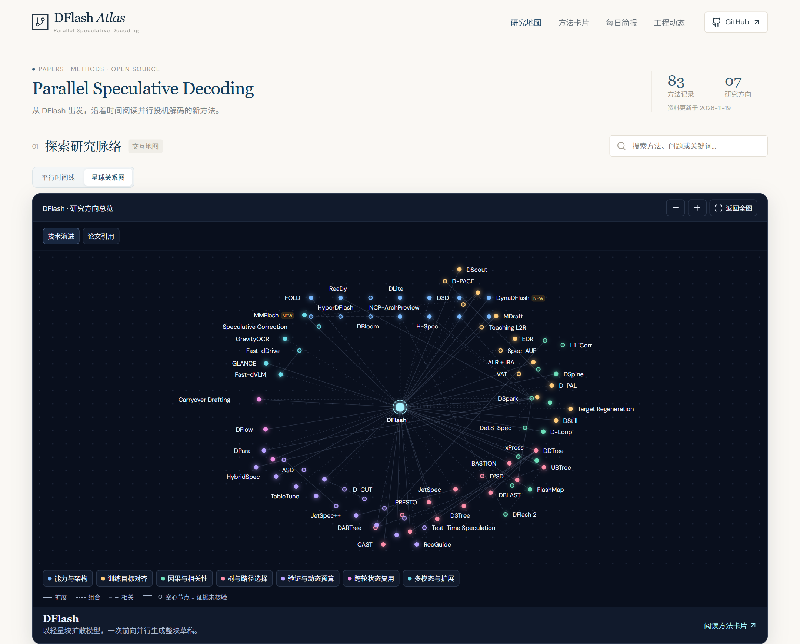
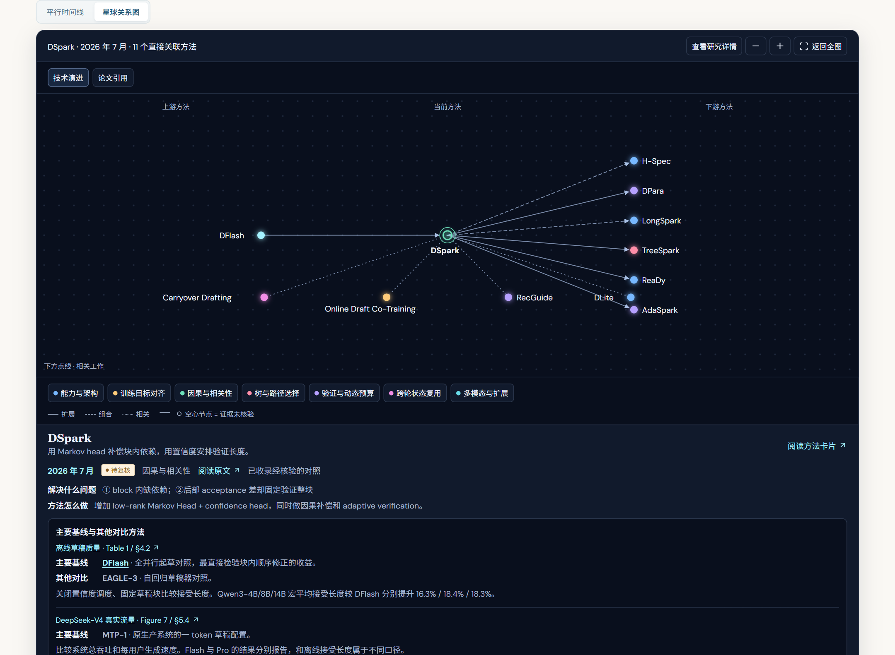

# DFlash Atlas

**从一篇论文出发，看清一个研究方向的全部后续工作。**

DFlash（Block Diffusion for Flash Speculative Decoding）之后，并行投机解码在不到一年里衍生出八十多个方法。
这里把它们的**问题、机制、实验基线、彼此关系**整理成一张可交互的星际图，并持续更新。

### [→ 打开交互地图](https://joelulu.github.io/Awesome-Parallel-Speculative-Decoding/)

83 个方法 · 79 条已核验关系 · 90 组基准对照 · 7 条研究主线 · 数据更新至 2026-11-19

每个节点都带证据等级：**实心 = 已核验，空心 = 论文身份或实验数字尚未二次核对**。不确定的条目不藏起来，但也不假装确定。

## 最近更新

| 日期 | 方法 | 它解决的问题 |
|---|---|---|
| 11-19 | [DynaDFlash](daily/2026-11-19.md) | 固定投影无法按当前上下文调整各层 target hidden 的贡献，改为按 token 动态门控 |
| 11-18 | [MMFlash](daily/2026-11-18.md) | 视觉依赖强的位置草稿质量差，按视觉依赖与草稿错误率重加权训练 |
| 11-16 | [D3Tree](daily/2026-11-16.md) | 固定树预算无法适配并发负载，学习节点存活率并按全批预算裁剪验证 |
| 11-13 | [DForkTree](daily/2026-11-13.md) / [Multi-Future Drafting](daily/2026-11-13.md) | 分叉后草稿分布失真、候选预算耗在拼接出来的假路径上 |
| 11-10 | [ChainFlow](daily/2026-11-10.md) | 单请求要更快，用一步 latent flow 与 token feedback 生成候选树 |

完整时间线、方法卡片与全部日报见[网站](https://joelulu.github.io/Awesome-Parallel-Speculative-Decoding/)。

## 点开一个节点，先看实验关系

选中任一方法后，卡片按四步回答：**它当时卡在哪 → 它怎么解决 → 主要基线与其他对照（表号、模型、设置、结论）→ 后来谁拿它当基线、谁扩展或复用了它**。
基线与后续都是双向可跳转的，证据不足时会明确标为待核实，不写成确定结论。

## 仓库里有什么

| 路径 | 内容 |
|---|---|
| `src/data/` | 唯一数据源：83 个方法、79 条关系、90 组基准对照、35 篇日报、工程雷达 |
| `src/` | 站点实现（React 19 + Vite 7，星球图与平行时间线双视图） |
| `daily/` | 每日简报原始记录，含当日的路线判断 |
| `engineering/` | 工程雷达：vLLM、Speculators、SGLang、SpecForge、TensorRT-LLM 的 PR 与 Issue |
| `docs/` | 研究方法论、检索与核验流程、新增一个方法的具体步骤、专题派生规则 |
| `topics/` | 专题：派生式（草稿树，39 个方法）与跨领域自带数据（视频缓存，13 个方法） |
| `archive/` | 历史版本（旧版整页 README 与论文时间线） |

## 参与维护

- 新增或修订一个方法：见 [docs/METHOD.md](docs/METHOD.md)
- 把这套方法复用到新方向：见 [skills/research-atlas/SKILL.md](skills/research-atlas/SKILL.md)
- 做另一个专题（派生：高并发草稿树；跨领域：视频缓存）：见 [docs/TOPICS.md](docs/TOPICS.md)
- 调整重要性口径：改 `scripts/rescore-importance.mjs` 的权重后跑 `npm run rescore`，报告写到 `docs/importance-report.md`，不要手改 JSON
- 提交前跑 `npm ci && npm run validate && npm test`，数据校验会拦截重复论文、断链与非法关系
- 改了界面记得 `npm run shots` 重新生成首页截图，`npm run smoke` 复测节点切换
- 网站本地预览与发布：见 [WEBSITE.md](WEBSITE.md)

## 核心参考

> **DFlash: Block Diffusion for Flash Speculative Decoding** — [arXiv:2602.06036](https://arxiv.org/abs/2602.06036)
