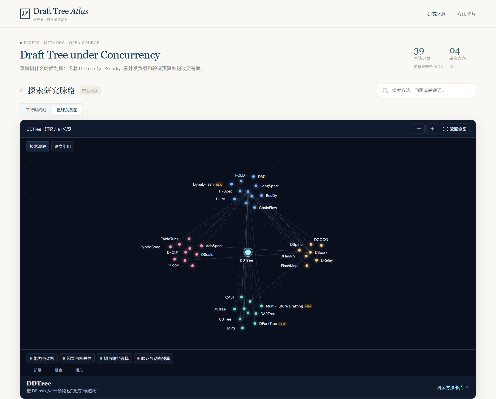
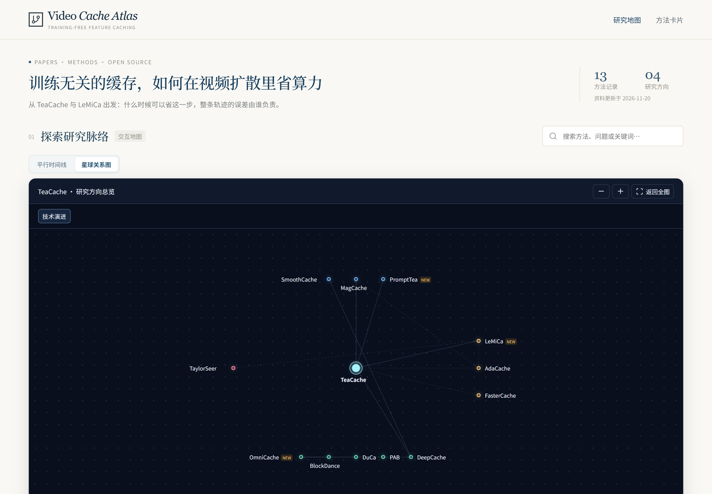

# 专题：一份数据，多个站点

DFlash Atlas 的地图、卡片、时间线和发布流程是通用的。换一个专题，不需要复制组件。

有两种模式，区别在数据从哪来：

| 模式 | 数据来源 | 适用 |
|---|---|---|
| `derive`（默认） | 从 `src/data/` 主库取子集 | 同一个领域切一个侧面（如草稿树） |
| `standalone` | 自带 `topics/<slug>/data/` | 换领域：新领域的方法根本不在主库 |

**派生**只改配置，同一套代码渲染出以 DDTree 为中心的图，四条主线变成「能力与架构 / 因果与相关性 / 树与路径选择 / 验证与动态预算」：



**自带数据**换的是领域，不是范围：`topics/video-cache/` 里是 13 篇视频扩散缓存论文，以 TeaCache 为中心，四个方向是「复用判据 / 全局调度 / 缓存粒度 / 特征外推」：



这张图就是跨领域复用的验收证据：组件、地图、时间线、发布流程一行没改，只换了数据与配置。

## 数据流

```
src/data/                    主库：83 个方法、79 条关系、90 组基准（唯一事实来源）
    │
    ├── atlas.config.json    → scripts/build-atlas.mjs  → src/data/atlas.json
    │                                                      （标题、根节点、功能开关）
    │
topics/<slug>.json           专题配置（种子、范围、文案）
    │
    ├── scripts/derive-topic.mjs
    │        ├─ derive 模式：从主库取子集
    │        └─ standalone 模式：读 topics/<slug>/data/，只校验不改写
    │        └→ src/topics/<slug>/{methods,relations,benchmarks,...}.json
    │
scripts/select-topic.mjs     把选中数据集装配到 src/active/
    │
src/lib/dataset.ts           站点唯一数据入口，组件不再直接读 JSON
```

`src/active/` 和 `src/data/atlas.json` 都是派生物，已在 `.gitignore` 中，不入库。

## 三个命令

```bash
# 默认专题（DFlash）
npm run dev

# 派生专题：生成 → 预览 → 构建
npm run topic -- --config topics/draft-tree.json
VITE_ATLAS_TOPIC=draft-tree npm run dev

# 自带数据的专题：同一套命令
npm run topic -- --config topics/video-cache.json
VITE_ATLAS_TOPIC=video-cache npm run dev
VITE_ATLAS_TOPIC=video-cache npm run build

# 修改了 atlas.config.json 或主数据后，重新装配
npm run data
```

## 专题配置写什么

```jsonc
{
  "slug": "draft-tree",              // 目录名，也是 VITE_ATLAS_TOPIC 的取值
  "title": "Draft Tree Atlas",
  "root": { "id": "ddtree", "name": "DDTree" },   // 星图中心 / 时间线起点
  "seeds": ["ddtree", "dspark"],     // 种子方法，可以不等于根
  "categories": {
    "include": ["architecture", "tree", "systems", "causality"],  // 只保留这些方向
    "exclude": ["training", "reuse", "extensions"]
  },
  "expand": {
    "hops": 2,                       // 沿已核验技术关系扩展几跳
    "relationTypes": ["extends", "combines", "related"],
    "minImportance": 4               // 丢弃重要性低于此值的边缘工作
  },
  "site": {
    "brand": { "lead": "Draft Tree", "tail": "Atlas" },
    "headline": "Draft Tree under Concurrency",
    "tagline": "……",
    "features": { "briefs": false, "engineering": false }
  }
}
```

`site.features` 控制四个可选模块：每日简报、工程雷达、GitHub Star 排序、论文引用层。关掉的模块整段不渲染，章节编号自动顺延。

## 自带数据的专题怎么写

```jsonc
{
  "slug": "video-cache",
  "mode": "standalone",
  "sourceDir": "topics/video-cache/data",   // methods / categories / relations / benchmarks 放这里
  "root": { "id": "teacache" },
  "seeds": ["teacache", "lemica"],
  "site": { "brand": { "lead": "Video", "tail": "Cache Atlas" } }
}
```

自带数据不是我编的，也不是模型生成的：每篇论文的 id、标题、日期、作者、摘要结论都按 arXiv abs 页核对过，代码仓库用 HTTP 200 逐个验过存在性（`facebookresearch/AdaCache`、PAB 的旧仓库路径都 404，所以干脆不给链接，卡片显示「代码待补充」）。

`derive-topic` 在 standalone 模式下只做两件事：跑主库那套 `validate-data` 全部规则，再把数据装配到 `src/topics/<slug>/`。**不裁剪、不改写**——取子集是 derive 模式的职责，换领域时取舍由人做。

### 这个专题的证据天花板要说清楚

13 个方法全部标记为 `status: imported`、`citationStatus: confirmed`，也就是「论文身份已确认，但没读全文」。展示出来是「导入未核验」角标。关系边是摘要层面的判断，每条 note 都以「摘要依据：」开头，说明它引用的是哪句结论。

这是刻意留的债：宁可让读者看到 13 个「导入未核验」，也不要把读摘要的结论标成已核验。下一步是逐篇读正文，把 `status` 升级到 `verified`，并补齐 PAB、BlockDance、OmniCache 等缺失的代码入口。

## 派生规则（重要）

生成器**只做取子集，不新增任何方法和关系**。专题里的每一条数据都能回溯到主库，这样同一套卡片才敢对外复用。

1. 种子必须存在于主库，否则直接报错退出
2. 沿 `status=verified` 的技术关系做 `hops` 跳扩展；引用边不参与——它只说明「提到过」，不代表同一问题域
3. 按 `categories` 与 `minImportance` 收窄范围，种子永远保留
4. 关系两端必须在子集内，基准的 `methodId` 必须在子集内，分类必须存在——三条断言不过就中止
5. 简报只保留提到子集方法的条目；Star 只保留子集里出现过的仓库

## 一次只跑一个数据集

`src/active/` 是单目录，两个不同专题的 dev/build 同时跑会互相覆盖。切换时按顺序操作：

```bash
# 停掉当前 dev → 装配 → 启动
VITE_ATLAS_TOPIC=draft-tree npm run data && VITE_ATLAS_TOPIC=draft-tree npm run dev
```

注意 `npm run build` 也会重新装配，在专题 dev 运行期间跑一次默认构建会把 dev 的数据换掉。

## 已知边界

- **关系天然稀疏**：以 TAPS 为例，它有 43 条基准记录，但技术关系上没有下游，局部视图就只有两个上游。这是数据现状，不是渲染问题，卡片里「后续被用作基线」才是它的真实影响面
- **根节点的月份不进时间线导航**：根单独摆在左侧，它所在的月份若没有其他方法，月份条会跳过该月
- **专题不继承工程雷达**：`engineering.json` 与具体论文方向绑定，派生时按空处理
- **小专题不能沿用结构分排重要性**：`npm run rescore` 依赖「被继承次数 / 被当作基线的次数」，这两个信号在十几条手写关系的规模上几乎是噪声，实测把 LeMiCa 算成 3 分。节点数少于约 30 时改用编辑分层，再用 `npm run rescore -- --dir <专题目录> --audit` 检查分布上限与依据是否齐全
- **跨领域复用已验证，但只到「同一套组件能吃新数据」**：视觉与交互完全复用，`categories.json` 仍需人工重做——分类口径是这个方法里唯一无法自动化的部分
